# ARCHITECTURE

## 概觀

拆件 → 生圖 → 生模型 → 減面 → 匯出。判斷交給人，固定流程交給腳本，狀態全記在 manifest，中斷後可接續。

| 元件 | 位置 | 角色 |
|---|---|---|
| User | 本地 | 透過 SSH tunnel 審核 |
| Agent (Claude / GPT / ...) | 任意 | 依 `docs/PROMPT.md` 拆件，輸出 manifest JSON |
| Gradio | 遠端 | 審核頁面、背景佇列、manifest 唯一寫入者 |
| ComfyUI | 遠端 | 工作流 A、B |
| Blender (headless) | 遠端 | 縮放、減面、截圖、匯出 |
| Coding Agent | 遠端 | 處理例外 (Blender MCP) |

## 循序圖

```mermaid
%%{init: {
  "theme": "base",
  "themeVariables": {
    "fontSize": "15px",
    "actorBkg": "#0f172a",
    "actorBorder": "#38bdf8",
    "actorTextColor": "#f8fafc",
    "actorLineColor": "#475569",
    "signalColor": "#94a3b8",
    "signalTextColor": "#e2e8f0",
    "sequenceNumberColor": "#0f172a",
    "noteBkgColor": "#1e293b",
    "noteBorderColor": "#64748b",
    "noteTextColor": "#f1f5f9",
    "labelBoxBkgColor": "#334155",
    "labelBoxBorderColor": "#64748b",
    "labelTextColor": "#f8fafc",
    "loopTextColor": "#cbd5e1"
  }
}}%%
sequenceDiagram
    autonumber
    participant U as User
    participant A as Agent
    participant S as Gradio
    participant M as manifest
    participant C as ComfyUI
    participant BL as Blender

    Note over S,BL: 遠端主機
    Note over U,S: SSH tunnel (localhost:7860)

    rect rgb(23, 37, 84)
    Note over U,BL: 階段 0：拆件與匯入
    U->>A: 場景需求
    A-->>U: 拆件草案
    U->>A: 確認
    A-->>U: manifest JSON
    U->>S: 貼上 JSON
    rect rgba(255, 255, 255, 0.07)
    alt 驗證通過
        S->>M: 依 project 分流，依 id 合併
    else 驗證失敗
        S-->>U: 顯示錯誤
    end
    end
    end

    rect rgb(84, 48, 8)
    Note over U,BL: 階段 1：生圖審核
    loop 每個 pending_image 部件
        S->>C: 工作流 A (subject、多個 seed)
        C-->>S: 候選圖
        S->>U: ⏸ 斷點 1
        rect rgba(255, 255, 255, 0.07)
        alt 選定
            U->>S: seed
            S->>M: image_approved
        else 重跑
            U->>S: 修改 subject
            S->>C: 新 seed
        end
        end
    end
    end

    rect rgb(6, 50, 40)
    Note over U,BL: 階段 2：生模型與減面審核
    loop 每個 image_approved 部件
        S->>C: 工作流 B (選定圖)
        C-->>S: GLB
        S->>BL: 縮放、Remesh、Decimate
        BL-->>S: 預覽、截圖、面數
        S->>U: ⏸ 斷點 2
        rect rgba(255, 255, 255, 0.07)
        alt 通過
            S->>BL: 匯出 FBX
            S->>M: done
        else 調整參數
            U->>S: 尺寸、voxel size、面數
            S->>BL: 更新預覽
        else 重跑
            S->>C: 新 seed
        end
        end
    end
    end

    Note over U,BL: 例外：以 Blender 或 Coding Agent (Blender MCP) 手動修模型
```



## 專案與 manifest

資料放在設定檔所在目錄的 `projects/`，預設設定檔為 `~/whittle/config.toml` (不存在則用預設值)，可用 `--config` 指定；啟動時會印出實際路徑。每個專案一份 `projects/<project>/manifest.json`。匯入時依 JSON 的 `project` 分流，不存在就建立；Gradio 同時管理所有專案，不需切換。

```json
{
  "project": "dock",
  "parts": [
    {
      "id": "barrel",
      "subject": "a wooden barrel with iron bands",
      "ref_axis": "height",
      "ref_size_m": 0.9,
      "decimate": { "voxel_size": 0.01, "target_faces": 800 },

      "status": "pending_image",
      "image": { "seed": null, "path": null },
      "model": { "seed": null, "path": null },
      "outputs": { "blend": null, "fbx": null }
    }
  ]
}
```

- 上半部由 Agent 提供 (欄位規則見 `docs/PROMPT.md`)，下半部由 Gradio 維護；`decimate` 是斷點 2 的參數初始值。
- 匯入前備份，依 `id` 合併，既有部件跳過。跨專案以 `<project>/<id>` 識別部件，`id` 只需在專案內唯一。
- 狀態：`pending_image` → 斷點 1 選定 → `image_approved` → 斷點 2 通過 → `done`。重跑不改變狀態。
- 進行中的任務不寫入 manifest；重啟後依狀態重新排隊，輸出已存在就直接進入審核。

## 背景佇列與審核

- 所有專案共用一條佇列，依 manifest 狀態決定要做什麼，已存在的輸出直接跳過，重啟或重新排隊都安全。
- 審核頁面不分專案，先生成好的先審 (候選圖或 `preview/result.json` 的修改時間)，送出後立即顯示下一件。
- 頁面上方狀態列每秒更新目前進度與各狀態件數；審核頁面空著時，有部件生成完成就自動填入。
- 重跑圖：更新 subject，刪除 `images/` 後重新排隊。重跑模型：刪除 `model/`、`preview/`、`.blend`、`.fbx` 後重新排隊。
- 刪除部件：從 manifest 移除並刪除 `parts/<id>/`，不備份。處理中的部件不可刪，排隊中的會被略過；已送進 ComfyUI 的 prompt 仍會執行，但結果不下載。

## ComfyUI 工作流

工作流檔案隨套件放在 `src/whittle/comfy/`，可在 `config.toml` 改指向自己的檔案。

- **A (`t2i.api.json`)**：`IN_subject` → FLUX.2 Klein → `OUT_image`，每個部件送出 `review.candidates` 個 seed。
- **B (`i2m.api.json`)**：`IN_image` → Hunyuan 3D 2.1 → `OUT_mesh` (GLB)。

介面節點依標題尋找 (在 ComfyUI 畫布設定標題後再匯出 API 格式)：

| 標題 | 節點 | 腳本操作 |
|---|---|---|
| `IN_subject` | String | 寫入 `value` |
| `IN_seed` | Int | 寫入 `value` (A、B 各一個) |
| `IN_image` | Load Image | 寫入上傳後的檔名 |
| `OUT_image` | Save Image | 下載候選圖 |
| `OUT_mesh` | Save 3D Model | 下載 GLB |

換模型只需替換中間節點、重接介面節點後重新匯出。API：`/prompt` 送出、`/history` 輪詢、`/view` 下載、`/upload/image` 上傳。

## Blender

```
blender --background --python src/whittle/blender/process_mesh.py -- --mode <mode> --part-dir <path> --params <json>
```

- `create`：匯入 GLB (合併網格、刪除頂點數不到 1% 的碎塊、底部中心移到原點) → 等比縮放 (寫入網格，voxel size 即公尺) → 加 Remesh + Decimate (不套用) → 存 `.blend` 並產生預覽。
- `update`：以新參數更新 `.blend` 與預覽。`export`：套用修改器匯出 FBX。
- 成功時寫 `preview/result.json` (`export` 寫 `export.json`)；失敗時 traceback 輸出到 stderr、exit code 1，不動結果檔。
- 斷點 2 通過時，記錄 `result.json` 中實際套用的參數，而不是表單上尚未預覽的值。

## 部件目錄

```
projects/<project>/parts/<id>/
├── images/<seed>.png   # 候選圖，數量達 review.candidates 即進入斷點 1
├── model/<seed>.glb    # 工作流 B 原始輸出
├── preview/            # decimated.glb、original.png、wireframe.png、result.json (有它即進入斷點 2)
├── <id>.blend
├── <id>.fbx
└── export.json
```

## 未來擴充

- 場景組裝 (Blender MCP)
- 貼圖階段 (需在減面後進行，Remesh 會破壞 UV)
- 常駐 Blender
- LLM 協助改寫 subject
